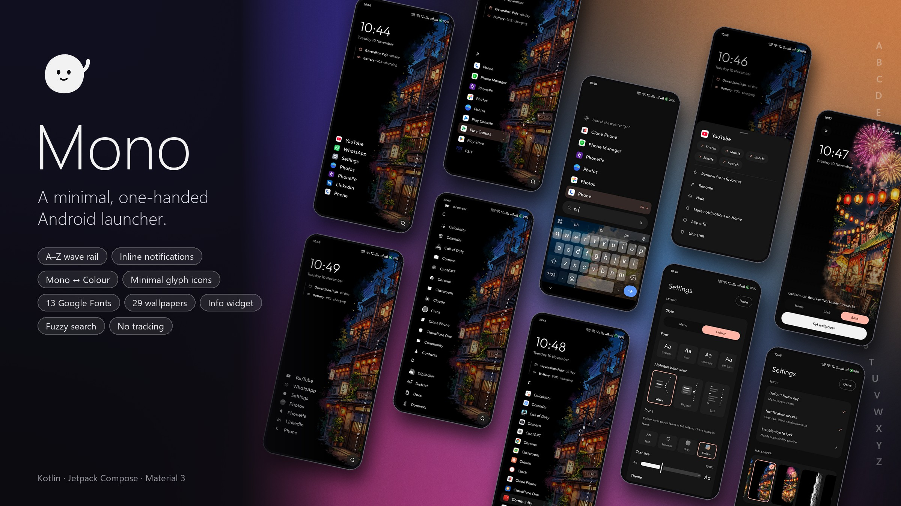
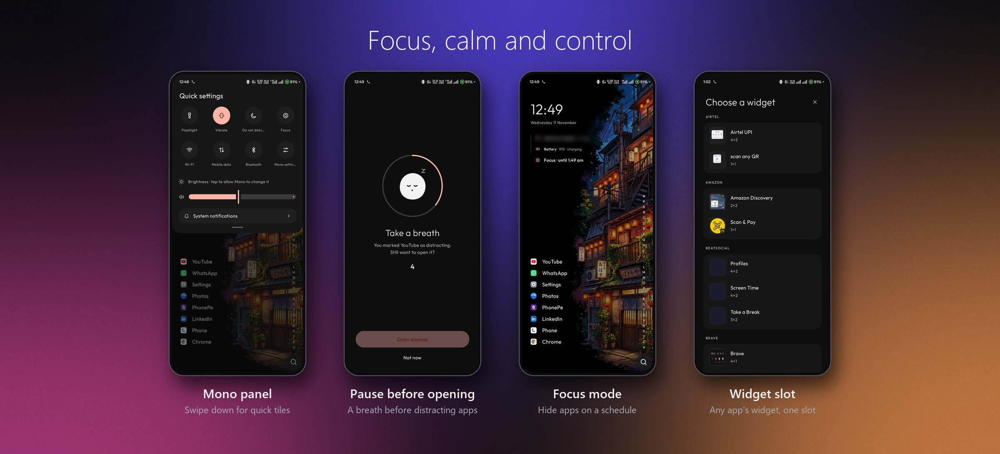

# Mono

**A minimal, one-handed, text-first Android launcher.**
Your favorite apps sit at the bottom of the screen within thumb reach, every other app is one slide away on the A–Z rail, and notifications appear as a single line under the app they belong to. No account, no ads, no tracking: everything stays on the phone.



---

## Features

### Home
- **Favorites:** up to 8 apps in a calm vertical list near the bottom of the screen. Long-press and drag to reorder; long-press in place for app actions.
- **Clock and date:** tap the time to open Clock, tap the date to open Calendar. Updates from the system's minute tick, with no timers.
- **Info widget:** a thin timeline under the clock showing:
  - **Next alarm** (e.g. "Alarm · Tomorrow 6:30 AM"). Tap to open Clock.
  - **Today's next calendar event** (optional, needs calendar access). Tap to open Calendar.
  - **Battery level and charging state.** Tap to open battery settings.
- **Inline notifications:** the latest notification for each favorite shows under its name, with a "3 new" badge.
  - Tap the line to open it; swipe it left to dismiss.
  - Ongoing and silent notifications are skipped, and you can mute any app on Home.
- **Media card:** now-playing controls (previous, play/pause, next) from whichever app is playing music.
- **Search button:** a round button in the bottom corner, on the same side as the rail.

### A–Z rail, three behaviours
Pick one in **Settings → Alphabet behaviour**:

| Style | What happens when you slide your thumb on the letters |
|---|---|
| **Wave** (default) | The letters bend into a smooth curve away from your thumb. That letter's apps replace your favorites while the clock stays put. Slide sideways onto an app and let go to open it. |
| **Popout** | The letter magnifies and a compact card of its apps pops out next to your thumb. |
| **List** | A full, scrollable A–Z list with letter headings. Dragging the rail jumps the list to that letter. |

In all three styles:
- ★ at the top shows your favorites, `#` groups apps starting with a digit or symbol, and ▣ is a separate section for work-profile apps.
- Letters with no apps are faded and skipped.
- You feel a crisp vibration tick for every letter, a click when an app opens, and a heavier bump when you lift a favorite to reorder.
- Letting go on the rail keeps the list open so you can tap or scroll it. This is also how it works with TalkBack.
- The letters follow the phone's language: non-Latin scripts get their own index letters, and the rail mirrors for right-to-left languages.

### Search
- Swipe up anywhere, or tap the search button.
- Matching is forgiving: start of the name, start of any word, initials ("gm" finds Google Maps), letters in order ("wtsp" finds WhatsApp), and it ignores accents.
- Results grow upward so the best match sits right above the keyboard, highlighted with a **Go →** hint. The keyboard's Go key opens it.
- With nothing typed, it shows your most-used apps. There's also a "Search the web for…" row, and "Mono settings" appears as a result when it matches.

### App actions (long-press any app)
- App shortcuts (such as "New chat" or "Search") as chips.
- Add to or remove from favorites, rename, hide, and mute notifications on Home.
- Pause before opening (marks the app as distracting) and hide during focus.
- App info and uninstall.

### Look and feel
- **Style:** **Mono** (black and white) or **Colour**. Colour shows full-colour icons and takes an accent colour from your wallpaper (Material You on Android 12+, a soft blue on older phones).
- **Icons:**
  - **Text only.**
  - **Minimal:** single-colour glyphs. Mono uses the app's themed icon when it has one, and otherwise builds a glyph from its logo.
  - **Greyscale.**
  - **Full colour.**
- **Fonts:** 13 Google Fonts (System, Inter, Manrope, DM Sans, Outfit, Sora, Space Grotesk, IBM Plex Sans, Lexend, Poppins, JetBrains Mono, Fraunces, Playfair), fetched on demand through Google Play services.
- **Theme:** Light, Dark, follow the system, or Material You.
- **Text size:** 80–140%, on top of the system font size.
- **Rail side:** right or left edge, for left-handed use.
- **Wallpapers:** 34 hand-picked wallpapers built in. Preview each one with the clock on top, then set it for the Home screen, the Lock screen or both.
- **Mo,** a small pebble mascot, appears in onboarding, empty states and the Settings footer, and is the app icon (with a themed version for Android's matching-icon mode).

### Focus and calm



- **Focus mode:** choose apps to hide, then start focus for 30 minutes, 1 hour or 2 hours, or set a schedule (start and end times, any days, including overnight).
  - While focus is on, those apps and their notifications disappear from Home, the A–Z rail and search.
  - A quiet "Focus · until 6:00 PM" line shows under the clock.
- **Pause before opening:** mark apps as distracting (long-press, then "Pause before opening").
  - Opening one shows a short breathing pause with Mo and a countdown ring (3, 5 or 10 seconds) before "Open anyway" unlocks.
  - "Not now" takes you back to Home.

### Mono panel (swipe down)
- **Tiles:** flashlight, ringer (sound / vibrate / silent), Do Not Disturb, Focus, Wi-Fi, mobile data, Bluetooth, and Mono settings.
- **Sliders:** brightness and media volume.
- **System notifications:** a button that opens Android's own notification shade.
- Wi-Fi, mobile data and Bluetooth open Android's small connection panels, since apps can't switch these directly on Android 10 and newer.
- Silent mode and Do Not Disturb need Do Not Disturb access, and brightness needs "modify system settings". The panel asks the first time.

### Widget
- **Add one widget from any app** in Settings → Widget, and place it above or below your favorites.
- **Change or remove it** from the same screen.

### Gestures
| Gesture | Action |
|---|---|
| Tap an app | Open it |
| Long-press an app | App actions |
| Long-press and drag a favorite | Reorder |
| Swipe up | Search |
| Swipe down | Mono panel *(configurable; can open the system notification shade instead)* |
| Double-tap empty space | Lock screen *(configurable; needs Mono's accessibility service)* |
| Swipe right | Nothing by default *(configurable)* |
| Long-press empty space | Mono settings |

### Setup and data
- **Onboarding** in three steps: pick favorites, allow notification access (optional), set Mono as your Home app.
- **Hidden apps:** hide an app from the rail and search; unhide it in Settings.
- **Backup and restore:** export favorites, renames, hidden apps and settings (including focus and pause settings) to a JSON file, and import them again.
- **Work profile:** work apps carry a "work" tag and get their own section on the rail.

---

## Privacy
- **No account, no server, no analytics.** Mono has no internet permission of its own.
- Notification text and calendar events are read on the phone and never stored or sent anywhere.
- **No cloud backup:** Mono opts out of Android's Google Drive backup and device-to-device transfer, so your app list, launch counts and focus settings never leave the phone. Use Export settings for your own backup file.
- Fonts download through Google Play services' font provider, the same way system apps do.
- Optional permissions, all off until you grant them:

| Permission | Used for |
|---|---|
| Notification access | Inline notifications and the media card |
| Calendar | "Today's next event" in the info widget |
| Accessibility service | Double-tap to lock only; it subscribes to no events and can't read screen content |
| Do Not Disturb access | Silent mode and Do Not Disturb in the Mono panel |
| Modify system settings | The brightness slider in the Mono panel |

Mono finds your apps through Android's launcher interface, so it doesn't need permission to see every installed package.

## Performance
- No background polling: Mono updates only when Android reports a change (app installed or removed, new notification, alarm, battery level, minute tick). Focus checks the time once a minute, and only while Home is on screen.
- Dragging along the rail updates only the drawing, not the whole screen, so it stays smooth. Icons load lazily and are cached in memory.
- If the app database ever fails, Home falls back to an in-memory app list, so it never comes up blank.
- The release app is about 7 MB, including the 34 wallpapers.

---

## Tech
| | |
|---|---|
| Language / UI | Kotlin, Jetpack Compose, Material 3 |
| Architecture | Single activity, MVVM, StateFlow, Hilt |
| Storage | Room (apps, favorites, renames, launch counts), DataStore (settings) |
| System APIs | LauncherApps, NotificationListenerService, MediaSessionManager, RoleManager, WallpaperManager, AppWidgetHost, AccessibilityService, CalendarContract, CameraManager (flashlight), AudioManager, NotificationManager (Do Not Disturb) |
| Background | WorkManager (an occasional app-list refresh, as a safety net only) |
| Min / target SDK | 26 (Android 8.0) / 36 |

```
app/src/main/java/com/mono/launcher/
├── data/            Room, DataStore, app repository, search, letter index, icons, focus schedule, backup
├── notifications/   notification listener and in-memory notification state
├── media/           now-playing session tracking
├── wallpaper/       built-in wallpaper catalog and setter
├── widget/          app widget host, add/remove flow, Home widget slot
├── accessibility/   lock-screen service
├── system/          system intents and the panel's quick controls
└── ui/
    ├── home/        Home, A–Z rail (wave, popout, list), info widget, media card
    ├── panel/       Mono swipe-down panel
    ├── focus/       pause-before-opening screen
    ├── search/      search
    ├── sheets/      app actions and rename
    ├── settings/    settings, wallpapers, widget, focus and pause sections
    ├── onboarding/  first-run setup
    ├── common/      icons, Mo, controls, haptics
    └── theme/       colours, fonts, typography
```

## Build and install
Requirements: JDK 17 and the Android SDK (compileSdk 36).

To try Mono without building it, install the release APK on any phone running Android 8.0 or newer, then press Home and pick **Mono**.

```sh
./gradlew installRelease       # smoothest build; install on a connected phone
./gradlew assembleRelease      # app/build/outputs/apk/release/app-release.apk
./gradlew testDebugUnitTest    # unit tests
```

After installing, press Home and pick **Mono**, or finish the in-app onboarding.

> The release build is signed with the local debug key so it can be shared and installed directly. Set up a real signing key before publishing to the Play Store.

## Design
- [`docs/DESIGN_BRIEF.md`](docs/DESIGN_BRIEF.md) describes every screen and state, with the original sizes, colours and motion.
